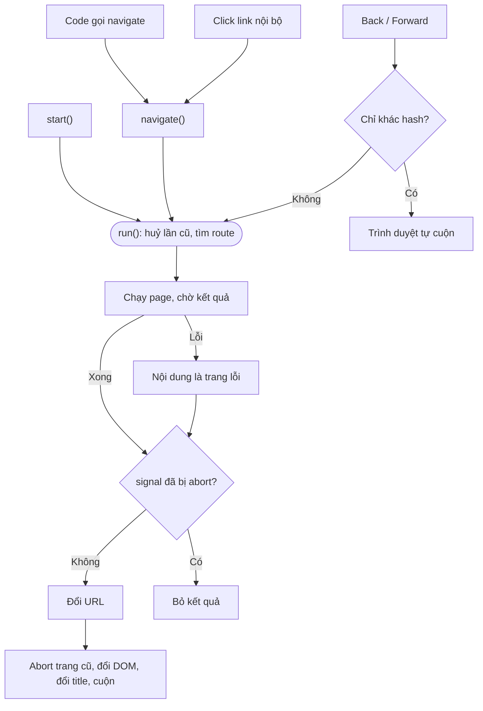
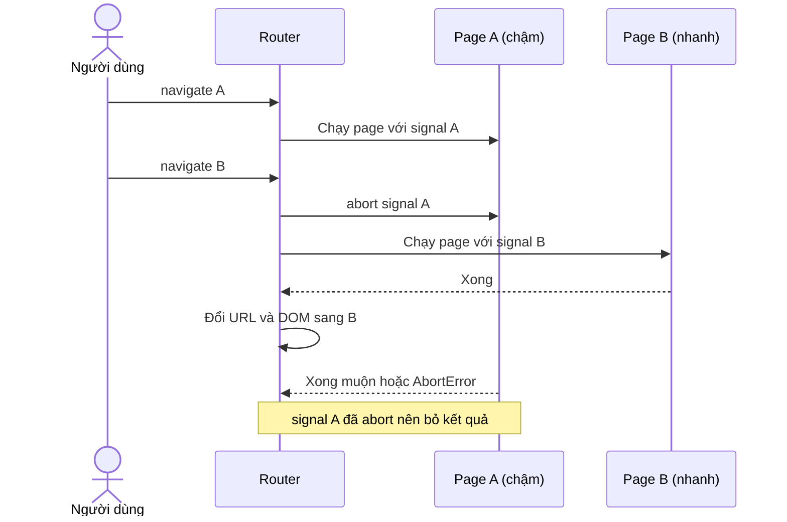

# Kiến trúc Router

Router này cố ý chỉ giữ phần lõi để dễ đọc. Cách dùng nằm ở [router-usage.md](./router-usage.md),
những gì còn thiếu và cách thêm nằm ở [router-todo.md](./router-todo.md).

## 1. Các file

| File                  | Trách nhiệm                                               |
| --------------------- | --------------------------------------------------------- |
| `src/main.ts`         | Điểm vào, gọi `startRouter(router)`.                      |
| `src/router.ts`       | Giữ router đang chạy, cung cấp `navigate()` cho toàn app. |
| `src/routes/index.ts` | Khai báo route và trang lỗi.                              |
| `src/routes/Route.ts` | Class `Router`.                                           |
| `src/routes/types.ts` | Kiểu dữ liệu.                                             |
| `src/pages/*`         | Các trang.                                                |
| `src/utils/auth.ts`   | Đăng nhập **giả** để minh hoạ.                            |

Page import `navigate` từ `router.ts` thay vì import bảng route, nhờ vậy không bị vòng lặp import.

## 2. Đọc `Route.ts` theo thứ tự này

1. **`compilePath`:** đổi `/users/:id` thành regex và danh sách tên tham số.
2. **`createContext`:** tạo object `ctx` mà page nhận được.
3. **`run`:** quy trình chính, đọc kỹ nhất hàm này.
4. **`handleClick`, `handlePopState`:** nơi sự kiện của trình duyệt đi vào router.

## 3. Quy trình một lần điều hướng

Tham số `mode` của `run()` quyết định cách ghi URL:

| `mode`    | Từ đâu                            | Ghi history    | Về đầu trang |
| --------- | --------------------------------- | -------------- | ------------ |
| `push`    | Link, `navigate()`                | `pushState`    | Có           |
| `replace` | `navigate(to, { replace: true })` | `replaceState` | Có           |
| Để trống  | Tải trang lần đầu, Back, Forward  | Không ghi      | Không        |

## 4. Vai trò của `AbortController`

Mỗi lần điều hướng có một controller riêng, dùng cho hai việc:

- **Bỏ kết quả cũ:** lần mới abort lần cũ, và lần cũ tự dừng khi thấy `signal.aborted`, nên trang tải chậm không đè lên trang người dùng vừa chọn.
- **Dọn dẹp trang cũ:** page truyền `ctx.signal` vào `fetch` và `addEventListener`, router abort nó khi rời trang.

Router giữ hai controller: `pending` cho trang đang chuẩn bị, `active` cho trang đang hiển thị.
Nhờ tách hai biến, trang cũ vẫn hoạt động bình thường trong lúc chờ trang mới.

## 5. Các quyết định thiết kế

| Quyết định                        | Lý do                                                           | Đánh đổi                                                          |
| --------------------------------- | --------------------------------------------------------------- | ----------------------------------------------------------------- |
| Dùng History API thay vì hash     | URL sạch.                                                       | Server phải trả `index.html` cho mọi đường dẫn.                   |
| Đổi URL ngay trước khi đổi DOM    | Trang cũ nguyên vẹn khi chờ; bị huỷ thì không để lại entry rác. | Page không được đọc `window.location`, phải dùng `ctx`.           |
| Chờ page async xong mới hiển thị  | Không có trạng thái nửa vời.                                    | API chậm thì trang cũ ở lại lâu, và chưa có thanh loading.        |
| Lắng nghe click ở cấp `document`  | Link render sau vẫn hoạt động.                                  | Link tới file tĩnh phải có `target` hoặc `download`.              |
| Kiểm tra origin trong `navigate`  | Chặn open redirect khi đích đến lấy từ `?redirect=`.            | Mở trang ngoài phải dùng `<a>` hoặc `location.assign`.            |
| Hash và cuộn giao cho trình duyệt | Gần như không tốn code.                                         | Vị trí cuộn khi Back có thể lệch trên trang dài hoặc trang async. |
